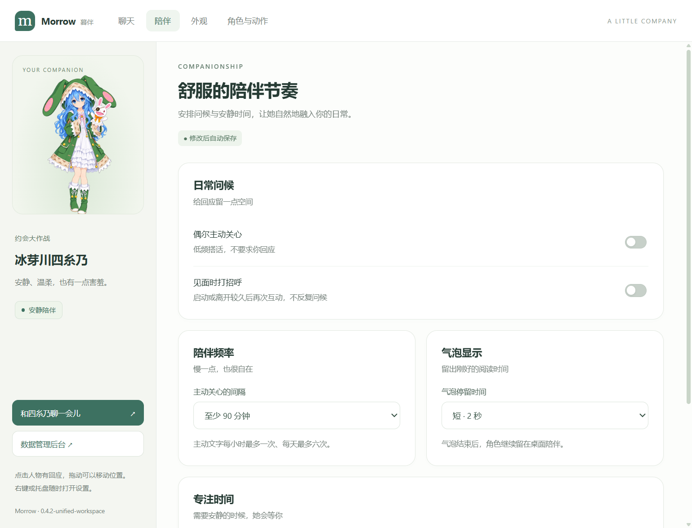
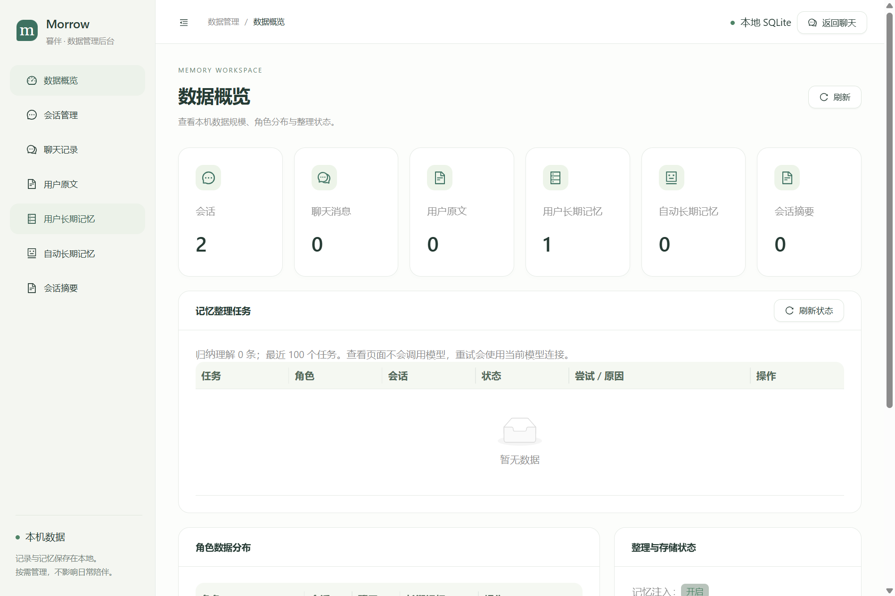

# Morrow · 暮伴

让角色陪在桌面，也留在对话里。

[功能](#功能) · [快速开始](#快速开始) · [配置与数据](#配置与数据) · [项目结构](#项目结构)

Morrow（暮伴）是一款可切换角色的桌面陪伴应用。它把透明桌面角色、文字聊天、表情动作、会话历史和长期记忆结合在一起。名字取自英文 morrow，寄意于持续相伴的每一天。

技术栈：Electron、TypeScript、React、LangChain.js、SQLite。当前版本为 `0.4.2-unified-workspace`，npm 包名为 `morrow-desktop`，Windows 程序为 `Morrow.exe`，Mac 应用为 `Morrow.app`。

新版聊天采用会话侧栏、自适应消息区和固定输入区，支持会话名称搜索；技术诊断折叠到会话详情。陪伴、外观、角色、模型和记忆页采用统一的暖白与薄荷绿布局，独立后台同步统一。设计说明见 [聊天工作区改版](docs/chat-ui-design.md) 和 [全局界面改版](docs/workspace-ui-design.md)。

## 界面预览

陪伴设置与独立数据管理后台。截图来自独立测试数据，没有真实用户聊天或密钥。





本轮记忆改造的规划、实现、数据结构及边界，见 [轻量记忆实施记录](docs/memory-implementation.md)。

完整的安装、配置、使用、记忆机制、角色制作、开发、打包与排查说明，见 [使用与开发指南](docs/guide.md)。

Mac 安装、开发、GitHub 自动打包和首次打开说明，见 [Mac 使用与构建说明](docs/macos-plan.md)。macOS 构建支持已接入，Mac 安装包和实机验收仍待首次构建验证。

## 功能

- 透明角色窗口、拖动、置顶、鼠标穿透、托盘和互动气泡。
- 切换角色时同步加载人设、提示词、图片、动作和互动规则。
- 流式聊天、停止生成、思考内容单独显示、图片附件和历史会话。
- 用户确认资料、自动来源事实、带证据的归纳理解及逐条可回查的会话摘要。
- 时间和依赖适用性判定、事实更新与纠错、持久整理任务及失败重试。
- 长对话超预算先压缩历史再继续发送，角色设定和长期记忆保留全量政策。
- 独立数据管理界面，查看、修订、删除和导出会话与记忆。

仓库提供四糸乃（`yoshino`）、五条悟（`gojo`）两个角色包，以及新角色模板。语音暂缓。模型服务地址、模型名称和 API Key 在应用设置中填写，无需训练模型。

## 快速开始

源码运行需要 Node.js 24 或以上版本及 npm。Windows 支持 x64；macOS 提供 Apple Silicon（arm64）和 Intel（x64）的构建配置。

Windows 的全屏检测辅助程序通过 .NET Framework 的 `csc.exe` 编译。Mac 会跳过此程序，使用手动安静模式。

在准备存放项目的目录打开 PowerShell，执行：

```powershell
git clone https://github.com/ayakadedog/morrow.git
cd morrow
npm ci
npm run build
npm run dev
```

安装时会下载对应系统的 Electron。Windows 首次构建生成全屏检测辅助程序，后续开发可直接执行 `npm run dev`。

首次打开后，进入 **聊天 → 模型连接**，填写服务地址、准确的模型 ID 和自己的 API Key，保存后即可聊天。可以选择 DeepSeek 专用适配或通用兼容接口；图片输入、思考模式和上下文上限需与实际模型能力匹配。没有模型连接时，桌面角色和预设互动仍可使用。

Mac 开发者在终端执行相同的三个命令即可。普通使用者拿到 DMG 后安装 `Morrow.app`，不需要安装 Node.js。Mac 测试包采用 ad-hoc 签名，尚未进行 Apple 公证。

## 检查与打包

所有命令均在仓库根目录执行：

```powershell
npm run roles:validate
npm run typecheck
npm test
npm run pack
```

`npm run pack` 生成 `release/win-unpacked/`。构建完成后，双击 `scripts/start.cmd` 启动 `Morrow.exe`；整个 `win-unpacked` 目录必须保留。`npm run dist:win` 用于生成 Windows 安装器。

仓库只保存源码和角色素材，运行包不会随 Git 提交。`scripts/start-workspace.cmd` 是本地按版本打包目录的启动入口，只有生成对应版本目录后才能使用；从 GitHub 克隆后按上面的标准构建流程操作即可。

Mac 上执行 `npm run pack:mac` 生成 `.app`，`npm run dist:mac` 生成 DMG。命令使用当前 Mac 的架构。Windows 开发者可使用仓库的 **Actions → Build macOS → Run workflow**，选择 `arm64`、`x64` 或 `both`，构建成功后下载 `Morrow-macos-架构` 产物。

跨平台基本验收为 `npm run verify:platform`，打包版为 `npm run verify:platform:packaged`。进一步的桌面验收命令为 `verify:desktop`、`verify:companion`、`verify:chat`、`verify:admin` 和 `verify:workspace`。先构建；验收使用 `data/tests/` 中的独立数据，向 `artifacts/` 输出报告和截图。脚本按系统选择 exe 或 Mac app 中的可执行文件；其他输出路径可通过 `MORROW_EXECUTABLE_PATH` 指定。详细场景的打包版可直接运行对应脚本，例如 `node scripts/verify-chat.mjs --packaged`。Mac 的原生全屏检测验收会跳过，其余详细场景仍需 Mac 实测。

当前 Windows 版本已通过 240 项单元测试，以及实际 Electron 构建中的页面、聊天、后台和桌宠本体验收。模型回归使用本地模拟服务；这些结果不代表所有云端服务商或 Mac 环境均已验证。

## 项目结构

```text
morrow/
├─ src/
│  ├─ main/              主进程、聊天、记忆、角色与窗口服务
│  ├─ preload/           主进程与界面的通信桥
│  ├─ renderer/          角色、聊天、设置与管理界面
│  └─ shared/            共享类型、配置格式和校验
├─ characters/           角色设定、互动配置与素材
│  ├─ _template/
│  ├─ yoshino/
│  ├─ gojo/
│  └─ registry.json
├─ scripts/              校验、构建、启动与桌面验收脚本
├─ tests/unit/           单元测试
├─ docs/                 架构说明
├─ resources/icons/      Mac 菜单栏图标
├─ .github/workflows/    Mac 自动构建
├─ package.json
├─ package-lock.json
├─ electron-builder.yml
└─ README.md
```

主要模块见 [架构说明](docs/architecture.md)，角色制作见 [角色包说明](characters/README.md)。角色内部使用 `profile/`、`interaction/` 和 `assets/`；资源路径以角色目录为根。

以下目录按需生成，并由 Git 忽略：

| 目录 | 用途 |
| --- | --- |
| `data/development/` | 开发运行的配置、聊天与记忆 |
| `data/local/` | 启动脚本使用的运行数据 |
| `data/tests/` | 独立测试与验收数据 |
| `artifacts/reports/`、`artifacts/screenshots/` | 验收报告和截图 |
| `out/`、`native/` | 编译输出与 Windows 辅助程序 |
| `release/` | 可运行构建和安装器 |

## 配置与数据

开发版读取仓库的 `characters/`，打包版读取 `resources/characters/`。角色修改后重新打包、重启运行版即可更新。

聊天原文、会话、摘要和记忆保存到数据目录中的 `chat.sqlite`。API Key 使用 Electron `safeStorage` 加密后保存到本机模型配置。直接启动构建 exe 时，使用 Electron 默认的用户数据目录（应用名 `morrow-desktop`）；启动脚本则固定使用 `data/local/`。`PET_DATA_DIR` 可覆盖数据路径，开发版的 `PET_CHARACTER_DIR` 可指定独立角色库。

API Key 在应用里填写，不需要写进源码、README 或角色包。`.gitignore` 排除了 `data/`、`local-config/`、`.env*`、密钥配置和数据库文件；提交前仍应检查暂存区，尤其不要使用 `git add -f` 强制加入个人数据。测试代码中的连接和令牌为模拟值。

## 素材与仓库范围

角色运行图片为 AI 生成的同人设计稿，来源与制作说明保留在各角色的 `assets/references/` 和 `profile/` 中。模板与参考资料不进入运行构建。

仓库保留程序、测试、构建脚本、角色运行素材和来源说明。个人配置、聊天记录、缓存、依赖、构建产物和历史验收记录由 `.gitignore` 排除。
