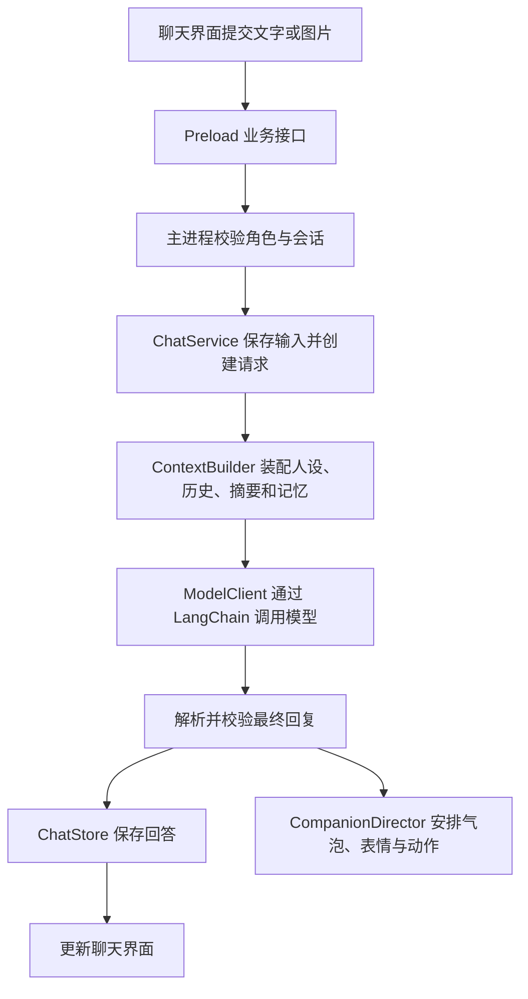

# Morrow（暮伴）使用与开发指南

本文的主体功能说明核对于 2026-10-07，聊天界面已于 2026-10-11 更新至 `0.4.1-chat-workspace`。聊天工作区布局与运行入口见 [聊天界面改版](chat-ui-design.md)。

Morrow 的仓库目录名为 `morrow`，npm 包名为 `morrow-desktop`，Windows 运行程序为 `Morrow.exe`，Mac 运行应用为 `Morrow.app`。本文中的文件路径均相对仓库根目录，命令也默认在仓库根目录执行。

macOS 构建支持已接入，实机验收待完成。Mac 的下载安装、GitHub 自动打包和已知限制，见 [Mac 使用与构建说明](macos-plan.md)。

## 阅读导航

| 你的目标 | 优先阅读 |
| --- | --- |
| 第一次运行项目 | [环境准备](#3-环境准备)、[安装与启动](#4-安装与启动)、[首次配置模型](#6-首次配置模型) |
| 日常使用桌宠 | [桌面交互](#5-桌面交互与设置)、[聊天与图片](#7-聊天图片与历史操作)、[会话和记忆](#8-会话确认记忆自动记忆与摘要)、[数据管理后台](#9-数据管理后台) |
| 修改人物性格与台词 | [角色包与人设编写](#11-角色包结构与人设编写)、[新增角色](#12-新增一个角色) |
| 继续开发程序 | [项目结构](#2-项目目录与文件职责)、[核心工作流程](#13-核心工作流程与开发入口)、[测试与验收](#14-测试与验收) |
| 保存或迁移自己的数据 | [数据保存、备份与恢复](#10-数据保存备份与恢复) |
| 准备提交 Git 或分发程序 | [打包与分发](#15-打包与运行分发)、[Git 提交与发布](#16-git-提交与发布) |
| 运行时出现问题 | [常见问题与排查](#17-常见问题与排查) |

项目摘要见 [README](../README.md)，模块速查见 [架构说明](architecture.md)，角色制作速查见 [角色包 README](../characters/README.md)。

## 1. 项目是什么

Morrow 是一款桌面角色陪伴应用，提供 Windows 与 macOS 的构建配置。角色可以显示在桌面上，回应点击和拖动，播放表情与动作，并通过配置的模型服务和你进行文字对话。

项目由三个相互配合的部分组成：

| 部分 | 负责什么 | 主要位置 |
| --- | --- | --- |
| 桌面宿主 | 窗口、置顶、拖动、鼠标穿透、托盘、气泡和演出时机 | `src/main/`、`src/renderer/` |
| 聊天与记忆 | 模型连接、上下文装配、会话、原文、摘要和长期资料 | `src/main/chat/` |
| 角色内容 | 人物身份、表达习惯、对白示例、图片和互动规则 | `characters/` |

例如，用户发送“今天工作有点累”，程序先结合当前角色的人设、适用资料和会话历史调用模型，再把回复显示到聊天面板，并按角色配置选择表情与动作。人物形象由本地程序渲染，模型不直接操作桌面窗口。

当前随仓库提供两个角色：

- `yoshino`：四糸乃，含四糸奈这个伴随说话者。
- `gojo`：五条悟，拥有自己的设定、图片和互动配置。

四糸奈属于四糸乃角色包中的说话者，不是独立角色，也不会单独建立另一份聊天空间。

### 1.1 当前实现的能力

- 透明角色窗口、拖动、置顶、轮廓区域鼠标交互和托盘入口。
- 点击、悬停、拖动反馈，以及低频的主动陪伴。
- 角色切换、表情和动作预览、气泡主题与快捷互动。
- 模型连接配置、流式回复、停止生成和推理内容单独显示。
- PNG/JPEG 图片聊天、附件持久化和历史图片查看。
- 新会话、会话恢复、重命名、历史加载、撤回、编辑重发和重新生成。
- 用户确认记忆、自动长期记忆、会话摘要及资料状态更新。
- 独立数据管理窗口，提供筛选、来源回查、修订、删除和 JSON 导出。

### 1.2 当前使用边界

本版以 PNG 角色和文字陪伴为主。Windows x64 已完成本地验证；macOS arm64/x64 已接入构建流程，安装与桌面表现待 Mac 实测。Mac 第一版使用手动安静模式，不自动检测其他应用全屏。语音功能暂缓，现有图片附件不等于持续读取屏幕。模型看到的是你主动发送的内容以及程序装配的上下文资料。

模型调用需要你配置服务。未配置模型时，本地的角色展示、固定互动与窗口功能仍可使用。人物的固定点击台词和模型生成的自由聊天，是两条不同的回应路径。

## 2. 项目目录与文件职责

```text
morrow/
├─ src/
│  ├─ main/
│  │  ├─ characters/      角色加载、校验与切换
│  │  ├─ chat/            模型、会话、原文、摘要和记忆
│  │  ├─ companion/       陪伴事件、频率与演出调度
│  │  ├─ platform/        运行路径与 Windows 全屏检测
│  │  ├─ settings/        外观和陪伴偏好
│  │  └─ storage/         启动时的数据库读写检查
│  ├─ preload/            有限的业务通信接口
│  ├─ renderer/           React 界面、角色舞台和动画播放器
│  └─ shared/             类型、输入校验、角色格式与几何计算
├─ characters/            角色制作源文件
├─ scripts/               校验、构建、启动与桌面验收
├─ tests/unit/            单元测试
├─ docs/                  项目文档
├─ resources/icons/       Mac 菜单栏模板图标
├─ .github/workflows/     Mac 自动构建与基础验收
├─ package.json           名称、版本、依赖和 npm 命令
├─ package-lock.json      锁定依赖版本
├─ electron.vite.config.ts
├─ electron-builder.yml
├─ tsconfig.json
├─ vitest.config.ts
├─ .gitignore
└─ README.md
```

以下目录由安装、构建或运行生成，不属于提交到 Git 的核心内容：

| 目录 | 用途 | 是否提交 |
| --- | --- | --- |
| `node_modules/` | npm 安装的依赖 | 否 |
| `out/` | Electron 主进程、Preload 与界面的编译输出 | 否 |
| `native/` | 构建生成的 Windows 全屏检测程序 | 否 |
| `release/` | 可运行构建和安装器 | 否 |
| `data/development/` | 源码运行时的数据 | 否 |
| `data/local/` | 启动脚本使用的数据 | 否 |
| `data/tests/` | 独立测试、验收的数据 | 否 |
| `artifacts/` | 验收报告、截图等产物 | 否 |

`characters/` 中的运行图片需要提交，否则其他人拿到代码后无法加载默认角色。图片生成的重复原图、个人聊天和本机密钥，不需要混在角色包里。

## 3. 环境准备

### 3.1 需要什么

| 环境 | 当前要求 | 用途 |
| --- | --- | --- |
| 操作系统 | Windows x64；macOS arm64/x64 构建待实测 | 桌面窗口与系统交互 |
| Node.js | 24 或以上 | 开发工具、脚本和类型处理 |
| npm | 随 Node.js 使用 | 安装锁定依赖和执行项目命令 |
| Windows .NET Framework C# 编译器 | 仅 Windows 需要 `csc.exe` | 编译 Windows 全屏检测辅助程序 |
| 模型接口 | 使用自由聊天时配置 | 生成对话、摘要或长期资料 |

在 PowerShell 中检查：

```powershell
node --version
npm --version
```

原生构建脚本默认查找 Windows 目录下的 `Microsoft.NET/Framework64/v4.0.30319/csc.exe`。具体调用见 [build-native.mjs](../scripts/build-native.mjs)。

Mac 上构建会跳过该辅助程序；终端可以执行同样的 npm 命令。普通 Mac 使用者安装 DMG 即可，不需要 Node.js 或 C# 编译器。

无需安装 Python、训练模型或先制作 Live2D。程序调用的是配置的模型接口；使用本地模型时，需要你先独立启动兼容的模型服务。

### 3.2 第一次安装

进入包含 `package.json` 的仓库根目录，再执行：

```powershell
npm ci
```

`npm ci` 根据 `package-lock.json` 安装依赖，适合复现仓库锁定的环境。安装过程包括 Electron 下载，需要能访问对应下载源。

日常运行不需要反复安装。只有依赖发生变化、依赖缺失或需要重新建立环境时，才重新执行安装。

## 4. 安装与启动

### 4.1 开发运行

首次执行：

```powershell
npm ci
npm run build
npm run dev
```

三个命令依次完成安装、首次编译和开发启动。Windows 首次构建会生成全屏检测辅助程序，Mac 会跳过。之后修改 TypeScript 或 React 代码，可以使用 `npm run dev` 开发。

开发运行默认使用 `data/development/` 保存设置、模型连接、聊天和记忆，读取仓库中的 `characters/`。

### 4.2 运行已有编译结果

```powershell
npm run build
npm start
```

`npm start` 对应 `electron-vite preview`，用于运行已经编译的应用。它与开发服务器不同，修改源码后需要先重新构建。

### 4.3 使用独立运行构建

```powershell
npm run pack
```

构建结束后，运行：

```powershell
.\scripts\start.cmd
```

也可以双击 `scripts/start.cmd`。它启动 `release/win-unpacked/Morrow.exe`，并将数据目录设置为 `data/local/`。

已经生成本次独立版本目录时，双击 `scripts/start-chat.cmd` 启动 `release/0.4.1-chat-workspace/win-unpacked/Morrow.exe`。它同样使用 `data/local/`，旧版本目录保留。日常聊天在左侧切换对话、记忆、模型连接，顶部仍可进入陪伴、外观和角色设置。

`win-unpacked` 是完整的应用运行目录。分发或移动时要带上整个目录，包含 exe、resources、语言文件和运行库。

### 4.4 三种运行方式的数据区别

| 运行方式 | 角色来源 | 默认数据来源 |
| --- | --- | --- |
| `npm run dev` / `npm start` | 仓库 `characters/` | `data/development/` |
| `scripts/start.cmd` | `release/win-unpacked/resources/characters/` | `data/local/` |
| 直接双击构建中的 `Morrow.exe` | exe 同目录下的 `resources/characters/` | Electron 默认用户数据目录 |

直接启动 exe 时，默认用户数据目录按应用名 `morrow-desktop` 生成。实际位置可在数据管理后台的数据目录详情中查看。

因此，开发版有聊天而直接启动 exe 后没有，可能只是两次使用了不同的数据目录。

## 5. 桌面交互与设置

### 5.1 基础操作

| 操作 | 结果 |
| --- | --- |
| 左键拖动人物 | 移动角色位置 |
| 单击人物 | 播放当前角色声明的固定互动 |
| 稳定悬停人物 | 按角色配置触发表情或回应 |
| 右键人物 | 打开菜单 |
| 气泡中的“聊天” | 打开聊天面板 |
| 气泡中的“设置” | 打开设置面板 |
| 托盘菜单 | 显示、收起、恢复位置、聊天、后台及退出 |
| 托盘双击 | 打开设置 |

固定互动由 `interaction/dialogues.json` 与 `behaviors.json` 决定，通常不需要调用模型。不同角色可以有不同的按钮和台词，不必使用同一套动作名称。

### 5.2 陪伴设置

“陪伴”页提供主动关心、启动问候、主动间隔、气泡停留时间和“安静 30 分钟”。

当前界面可选择至少 45、60、90、120 分钟的主动关心间隔。自动文字受到总频率限制：每小时最多一次、每天最多六次。满足时间间隔并不意味着立即说话，还要满足可见、非拖动、非安静等运行条件。

全屏应用、锁屏和设置或后台打开时，会暂停主动搭话。全屏检测不可用时，设置页会显示对应状态，可使用手动安静功能。

“偶尔主动关心”控制桌宠层面的主动陪伴；“用模型生成主动关心”是模型连接中的另一项设置。后者默认关闭，开启后才可能额外调用模型，而且仍受桌宠频率和安静规则限制。

### 5.3 外观设置

- 角色大小：界面允许在 240–680 范围内调整显示高度。
- 保持置顶：控制角色是否显示在其他窗口前面。
- 动作程度：完整、轻量、静态。
- 鼠标交互：自动、始终可以点击、完全穿透。

自动模式根据人物的透明区域判断鼠标交互。完全穿透后，人物本身不再方便点击，可通过托盘恢复。窗口跑到屏幕外时，使用“找回角色”或托盘中的恢复位置入口。

### 5.4 角色与动作

“角色与动作”页可以切换角色、预览表情、预览动作和停止动作。新角色准备失败时保留旧角色，不会只换一张图片却继续使用旧人设。

角色列表在启动时读取。新增角色登记后，需要重新启动；打包运行版还需要更新打包资源。

## 6. 首次配置模型

从聊天面板进入“模型连接”，依次设置模型适配、协议、API 根地址、准确的模型 ID 和 API Key，再保存。

### 6.1 字段说明

| 字段 | 作用 | 填写方法 |
| --- | --- | --- |
| 模型适配 | 选择 LangChain 的通用或 DeepSeek 专用适配 | 按服务类型选择 |
| 接口协议 | 选择 Chat Completions 或 Responses | 使用服务明确支持的协议 |
| API 根地址 | 模型服务的基础地址 | 通常填写服务提供的根路径，例如 `/v1` |
| 模型名称 | 服务实际识别的模型 ID | 使用账号可访问的准确名称 |
| API Key | 调用凭据 | 云端按服务要求填写；无密钥本地服务可留空 |
| 逐字显示回复 | 是否使用流式输出 | 服务不支持流式时关闭 |
| 图片输入 | 自动、开启或关闭图片读取 | 只有模型支持图片时才开启 |
| 思考模式/强度 | 向适配器传递推理设置 | 初次接入可保留服务默认 |
| 最大输出预算 | 为模型输出预留的 Token | 与服务能力、输入预算一起考虑 |
| 最长等待时间 | 应用等待请求的时间上限 | 推理较慢时可调整 |
| 上下文窗口 | 应用使用的上下文总预算 | 根据实际模型能力填写 |

地址示例：

```text
云端兼容服务：https://your-provider.example/v1
本地兼容服务：http://localhost:8000/v1
```

这里是格式示例，不是可直接使用的模型服务。地址不要填写成完整的 `/chat/completions` 路径，也不要附带 query、fragment 或 URL 用户名密码。

当前地址校验允许远程 HTTPS；HTTP 仅允许 localhost、127.0.0.1 或 IPv6 回环地址。本地服务地址的端口要与你实际启动的服务一致。

### 6.2 适配和协议

通用兼容服务可选择 Chat Completions 或 Responses。协议兼容性需要由服务本身提供，单纯切换选项不能让一个只支持 Chat Completions 的端点支持 Responses。

DeepSeek 专用适配使用 `ChatDeepSeek`，当前配置要求 Chat Completions。界面选择此适配后会预填地址和模型名；这只是程序预设，仍需根据实际账号与服务提供的可用模型核对。

本项目设置中的模型名称、上下文校验和图片自动识别规则是当前代码的实现，不是服务商能力的长期承诺。服务模型更新后，可在 `ModelConfig.ts`、`ModelClient.ts` 与 `shared/imageInput.ts` 中维护对应规则。

### 6.3 默认选项与预算

新配置的主要默认值由 [ModelConfig.ts](../src/main/chat/ModelConfig.ts) 定义：

| 配置 | 当前默认值 |
| --- | --- |
| 流式回复 | 开启 |
| 记忆注入 | 开启 |
| 自动摘要 | 开启 |
| 自动长期记忆 | 开启 |
| 模型主动关心 | 关闭 |
| 图片输入 | 自动 |
| 等待时间 | 120 秒 |
| 最大输出预算 | 12,288 Token |
| 上下文窗口 | 98,304 Token |

输入预算按“上下文窗口 − 最大输出预算”计算，保存时还要求为输入保留至少 4,096 Token。界面允许的数值范围不等于某个服务的实际支持范围。

例如，某服务提供的模型总窗口只有 32,768 Token，就不能因为应用默认值更大而继续按 98,304 使用；需要按该服务能力设置。

应用使用通用 Tokenizer 做保守估算。界面显示的估算与供应商实际计费 Token 可能不同。

### 6.4 密钥保存与第一次验证

密钥在主进程通过 Electron `safeStorage` 加密保存到本机模型配置，不放进角色包，也不回显到界面。

已经保存密钥时，同地址下留空可以保留原密钥。修改 API 根地址会清除旧地址对应的密钥，需要重新填写。界面另有显式清除密钥选项。

保存连接设置本身不调用模型。保存后发送一句简单文字，确认能得到最终回答，再尝试图片、推理或自动整理等能力。

发送消息、手动摘要、手动长期资料整理，以及开启后的自动整理，都可能调用当前模型。若希望先只验证普通聊天，可暂时关闭两个自动整理选项。

## 7. 聊天、图片与历史操作

### 7.1 文字聊天

在聊天输入框发送文字。Enter 发送，Shift+Enter 换行。生成过程中可以停止回复，流式文字逐步显示到聊天面板。

推理内容与最终回答分别处理。服务返回可展示的推理内容时，界面单独折叠显示；它不触发角色动作，也不会作为普通回答进入后续聊天与长期记忆。

桌面气泡是简短展示，较长回复可能被截短。查看完整回答请使用聊天面板。

### 7.2 图片输入

可以选择 PNG/JPEG 图片、查看附件预览，并发送文字加图片或纯图片消息。每条消息最多 4 张图片。

当前图片处理规则见 [ImageDrafts.ts](../src/main/chat/ImageDrafts.ts)：

| 项目 | 当前限制或处理方式 |
| --- | --- |
| 原图文件大小 | 每张不超过 10 MiB |
| 原始尺寸 | 最长边不超过 8,192 像素，总像素不超过 2,000 万 |
| 保存前缩放 | 最长边不超过 2,048 像素 |
| 保存后的大小 | 每张不超过 4 MiB，必要时继续缩小 |
| 图片草稿有效期 | 约 10 分钟，并绑定当前角色、会话和历史版本 |
| 单次上下文图片容量 | 当前实现最多 16 MiB |

图片会重新解码和处理，聊天保存的附件不保证与原始文件逐字节相同。角色切换、会话变化或草稿过期后，需要重新添加附件。

“图片输入”控制是否把图片内容发给模型。关闭后，已保存图片仍可以在历史中查看，但当前文字模型不会因此获得看图能力。

附件内容保存为 `chat.sqlite` 中的 BLOB，图片不会在发送后只依赖原始文件路径。删除本机的原图，不等于删除已经保存的聊天附件。

### 7.3 会话管理

“新对话”创建新的会话，旧会话仍保留。通过聊天中的“会话列表”或管理后台，可以搜索、重命名、选择与恢复会话。

界面初次显示的消息页与模型可用上下文不是同一个概念。历史可以继续加载，模型请求则由上下文预算、摘要和资料装配规则决定。

### 7.4 编辑、撤回与重新生成

| 操作 | 用途 | 对历史的影响 |
| --- | --- | --- |
| 编辑并重发用户消息 | 修正提问并重新接续 | 从该位置重新建立后续对话 |
| 撤回用户消息 | 移除该提问与后续依赖内容 | 按确认范围清理对应历史 |
| 重新生成模型回答 | 保留对应问题，重新请求回答 | 从该问题重新接续后续内容 |

这些操作不仅改变界面的文字，还会处理受影响的用户原文、来源记忆与摘要，防止旧结果再次被当成当前资料。执行前应查看界面给出的影响范围。

后台修订原文主要用于修正保存的数据，不会自动生成新回答；想让模型基于改后的问题继续回答，应使用聊天中的“编辑并重发”。

### 7.5 删除操作的范围

| 操作 | 删除或保留什么 |
| --- | --- |
| 新对话 | 创建新会话，保留旧会话和长期资料 |
| 忘记某条确认记忆 | 删除该记忆，保留原聊天；相关摘要可能失效 |
| 丢弃会话摘要 | 删除摘要，保留原文 |
| 聊天页“删除此角色聊天记录” | 删除该角色会话、两份原文、图片、摘要和相关自动资料；保留独立现实人工资料并解除旧消息来源，绑定剧情的人工资料随会话删除 |
| 后台删除一个会话 | 清理该会话及相关数据；来源属于该会话的确认记忆也会受影响，独立手动记忆保留 |

聊天页的整角色清空与后台的会话删除，确认记忆处理规则不同。操作前以界面的影响范围为准，不要把“忘记资料”“清空历史”和“新对话”视为同一个操作。

## 8. 会话、确认记忆、自动记忆与摘要

### 8.1 原文、资料、归纳与摘要

| 内容 | 谁产生 | 解决什么问题 | 是否等同于当前事实 |
| --- | --- | --- | --- |
| 原始聊天 | 用户与模型 | 保留完整交流过程 | 历史中可能包含旧事实、剧情、猜测 |
| 用户确认记忆 | 用户手动录入或确认 | 保存明确希望角色记住的资料 | 还需要结合适用状态和后续纠正 |
| 自动长期记忆 | 模型从原文整理 | 增量积累相关信息并保留出处 | 不直接等同于用户确认的客观事实 |
| 归纳理解 | 模型依据有版本的事实/人工资料 | 形成低优先级理解 | 不是独立证据，依据失效则暂停使用 |
| 会话摘要 | 模型或用户修订 | 压缩较早对话，保持当前会话连续性 | 有损历史材料，不自动变成长期事实 |

例如，聊天里说“故事中的我住在海边”，不应该直接变成现实住址。自动资料会区分现实、剧情或未知范围；摘要也应保留这些边界。

### 8.2 用户确认记忆

可以手动录入“我希望被叫阿林”，也可以在用户消息上选择“记住这句话”。条目在本机保存，按角色隔离。后台新增时可选择现实资料、剧情设定或范围未明确；现实资料可在同角色跨会话使用，另外两种必须绑定会话。聊天页“记住这句话”默认现实资料，剧情内容建议在后台明确选择范围。

想直接纠正内容，可以在管理后台的“用户长期记忆”修改。人工修订保存版本与时间，后续请求重新读取资料。

“忘记”移除的是记忆条目，原聊天中的那句话可能仍然存在。因此，删除记忆后，如果模型仍能从当前历史读到同样内容，它仍可能在回答中引用该内容。

### 8.3 自动长期记忆

自动长期记忆默认开启，并受模型已配置、记忆注入开关和当前任务状态影响。普通回复后以约 45 秒空闲窗口合并新增原文，累计至少六条用户原文可立即整理；包含明显搬家或纠正词句的消息约 1.5 秒后优先整理。这些关键词只改变调度时机，不决定事实如何更新。启动时检查各会话未整理的原文，并恢复持久任务。事实变化后约两分钟合并处理归纳理解。

整理请求同时包含新增原文和适用的已有资料，结果需要通过来源与格式校验才写入。生成、摘要或另一轮整理正在执行时，不会直接并发改写同一份会话状态。

自动资料保留来源消息、整理批次、角色版本、修订信息和适用范围。现实资料可在同角色的不同会话间使用，剧情或未知范围则限制在对应会话；角色版本与来源还需匹配。

自动整理可能出错，可在后台回查原文、修改或删除。整理失败时，程序保留原文和已有记忆，不把失败批次当成有效新资料。

### 8.4 记忆状态与事实变化

| 状态 | 含义 | 使用方式 |
| --- | --- | --- |
| `active` | 存储的候选状态 | 仍需通过日期、条件与依赖检查；程序的 `applicability.status=current` 才表示当前适用 |
| `historical` | 过去有效或历史信息 | 保留历史意义，不当作现状 |
| `retracted` | 已被纠错撤销 | 不继续当作有效事实 |
| `needs_review` | 需要核实 | 保留不确定性 |

例如，之前说“我住在上海”，后来明确说“我已经搬到北京”。正确处理不仅是增加“住在北京”，还要使旧资料不再被解释成当前住址。

当前整理机制可更新适用状态并关联新的来源。用户手写的确认内容不会因为模型整理就被随意改写成另一段文字；状态变化、人工修订与原始对话分别保留意义。

这里也有明确的时序区别：当前用户新纠正可以优先于旧资料，但一条已经归档的旧聊天，不应被重新当成“本轮用户又纠正了一次”。

### 8.5 会话摘要

长对话接近输入预算时，自动摘要可以整理较早的完整轮次。也可以在聊天的会话摘要区域手动“整理一批历史”。程序保留近期原文，并用摘要帮助覆盖较早历史。

摘要包含事件、用户陈述、剧情状态、不确定性、承诺、待回答问题等结构化内容。它有来源范围和角色版本，不会覆盖原始聊天。

摘要使用稳定条目 ID，保留现实/剧情范围、可能/否定/条件、未完成状态和确切原文 ID。旧数组协议和人工整体改写只能标记为批次出处，不伪装成逐项精确证据。每五版尝试从原文重新整理；覆盖原文超预算或超过当前单批范围时仍走增量整理。人工条目不能被自动改写。

如果本轮因旧历史超预算而不能发送，程序先压缩、再自动续发已保存的问题；核心设定和全量长期资料本身超预算时明确失败，不做无用的循环压缩。

“丢弃摘要”只移除摘要及条目，保留原文。若相关历史已被编辑或删除，摘要的来源可能失效，需要重新整理。

### 8.6 模型每轮会获得什么

上下文主要组合以下内容：

1. 当前角色的结构化设定、完整补充设定与提示词。
2. 独立的角色对白示例，用于学习表达和输出格式。
3. 当前作用域的自动长期资料与可用会话摘要。
4. 对应会话的真实历史原文，以及可读取的图片附件。
5. 用户确认记忆快照和本轮用户输入。

对白示例不是用户真实经历；资料和摘要也不是新的用户指令。程序在提示中区分这些来源，并说明当前信息与历史信息的优先关系。

角色设定和适用资料并非各自设置一个很小的数量上限后静默丢弃。总请求超过预算时，会提示调整预算或整理资料；“设置了更大的窗口”也不会改变模型服务本身的上限。

具体实现见 [ContextBuilder.ts](../src/main/chat/ContextBuilder.ts)。

## 9. 数据管理后台

通过设置底部的“数据管理后台”、托盘入口或聊天中的“会话列表”打开独立管理窗口。

| 页面 | 主要用途 |
| --- | --- |
| 数据概览 | 查看会话、消息、资料数量和存储状态 |
| 会话管理 | 按名称查找、筛选、重命名和管理会话 |
| 聊天记录 | 查看用户与模型的消息及详情 |
| 用户原文 | 查看独立保存的用户输入档案 |
| 用户长期记忆 | 查看、新增和修订用户确认资料 |
| 自动长期记忆 | 分别查看来源事实与归纳理解、筛选状态、追踪依据与原文 |
| 会话摘要 | 查看和人工修订历史摘要 |

后台支持角色、会话、关键词等筛选；会话管理还可按创建日期和有无聊天记录筛选。聊天记录、自动记忆和摘要等内容通常先按会话进入。

来源回查支持归纳 → 来源事实/人工资料 → 原文的链路，摘要条目也能逐项查看出处。概览展示最近 100 个整理任务的会话名称、状态、尝试次数与安全错误码；允许手动重试，浏览不会调用模型。

“导出筛选结果”导出当前筛选范围的全部结果，不只导出屏幕上这一页。导出是 JSON 数据文件，适合阅读、留档或做后续工具处理；当前仓库没有把这种导出文件自动恢复成完整应用状态的导入流程。

后台修改只保存资料，不自动续写回答。删除时以界面的确认范围为准；本机删除不会同步删除服务商侧的记录或已经导出的副本。

## 10. 数据保存、备份与恢复

### 10.1 数据目录中有什么

| 文件 | 主要内容 |
| --- | --- |
| `chat.sqlite` | 会话、双方聊天、用户原文、记忆、摘要和图片附件 |
| `chat.sqlite-wal`、`chat.sqlite-shm` | SQLite 运行时的 WAL 相关文件 |
| `chat-model.json` | 模型选项和加密后的密钥 |
| `preferences.json` | 位置、尺寸、穿透和陪伴偏好 |
| `companion-ledger.json` | 主动互动频率记录 |
| `chat-diagnostics.jsonl` | 请求结果、耗时等诊断信息 |
| `desktop.sqlite`、`startup-status.json` | 桌面启动与基础数据库检查 |

目录还可能包含 Electron 自己生成的缓存和浏览器状态文件。

当前聊天数据库使用 schema 12，并包含会话、消息、用户原文、确认记忆、会话摘要、自动资料及来源、记忆变化及来源、图片附件等表。新增 `memory_events`、`memory_jobs`、`memory_observations`、`summary_entries`、`memory_links` 和 `memory_suppressions` 六张表。事件表不存正文快照；旧版升级先使用 SQLite 一致性备份保存迁移前数据库。应用会按代码执行必要的结构迁移；更老的程序不能保证读取更新版本的数据库。

API Key 的加密不等于整个数据目录都经过加密。聊天与资料保存在 SQLite 中，应按自己的私人数据管理。

### 10.2 推荐备份方式

1. 在托盘或设置中退出应用，确认没有另一份进程继续使用相同数据目录。
2. 确认本次真正使用的数据位置，例如 `data/local/`。
3. 将整个数据目录复制到单独的备份位置。
4. 同时保留需要的角色源文件和对应版本的源码或运行构建。

备份完整目录能减少遗漏数据库、附件和配置的机会。数据库运行时可能有未合并的 WAL 内容，不要把运行中的 `chat.sqlite` 单独复制后就视为完整一致的备份。

### 10.3 恢复或换电脑

先退出程序，再把备份复制到计划使用的数据目录，之后使用与该数据库兼容的版本启动。

`safeStorage` 保存的密钥不保证能在另一台电脑或另一 Windows 用户下解密。数据迁移后，如果连接配置无法读取，应在新环境重新保存模型连接和密钥。

开发版、脚本运行版与直接启动 exe 的数据目录可能不同。不要只覆盖 `data/local/`，却在恢复后使用直接双击 exe 的默认目录。

### 10.4 指定独立数据目录

调试或测试时，可在当前 PowerShell 进程中指定：

```powershell
$env:PET_DATA_DIR = Join-Path (Get-Location) 'data/sandbox'
npm run dev
```

结束后，在该终端中移除覆盖：

```powershell
Remove-Item Env:PET_DATA_DIR
```

开发版还支持 `PET_CHARACTER_DIR` 指向独立角色库；该目录必须包含完整的 `registry.json` 及登记角色。打包版的角色路径由 `resources/characters/` 决定，不使用这个开发覆盖来替换打包资源。

## 11. 角色包结构与人设编写

### 11.1 角色包目录

```text
characters/my-character/
├─ manifest.json
├─ profile/
│  ├─ role.json
│  ├─ persona.md
│  └─ prompt.md
├─ interaction/
│  ├─ actions.json
│  ├─ behaviors.json
│  ├─ dialogues.json
│  └─ bubble.json
└─ assets/
   ├─ portraits/
   ├─ expressions/
   ├─ animations/
   └─ references/
```

角色 ID 是稳定标识，显示名可以改变。不要为了修改显示名随意改 ID，否则原来按 ID 保存的会话和记忆不会自然变成新 ID 的数据。

所有 manifest 资源路径以本角色目录为根，使用 `/`。不允许绝对路径、`..`、目录越界或符号链接。

### 11.2 三份人设文件的关系

| 文件 | 适合写什么 |
| --- | --- |
| `role.json` | 身份、性格、语气、关系、边界、背景知识、对白示例 |
| `persona.md` | 较完整的人物设定与补充说明 |
| `prompt.md` | 当前项目中的扮演方式和对话要求 |

三份内容会共同影响模型。修改时要保持一致，避免一份说“初次认识”，另一份却要求“默认已经是多年恋人”。

原作事实与本项目创作也应区分。`role.json.knowledge` 的 `canon` 条目要求 HTTPS 来源；原创设定使用 `project-design`。字段规则见 [roleProfile.ts](../src/shared/roleProfile.ts)。

### 11.3 结构化人设示例

以下示例展示一个原创角色的人设格式：

```json
{
  "schemaVersion": 1,
  "characterId": "my-character",
  "revision": "draft-1",
  "identity": {
    "name": "小悠",
    "work": "原创角色",
    "summary": "住在虚构小镇的书店店员，喜欢听人分享日常。",
    "traits": ["温和", "好奇", "认真"]
  },
  "speech": {
    "tone": "自然、轻松，使用简短中文",
    "rules": ["先回应对方正在说的事", "需要时提出一个具体问题"],
    "avoid": ["每句话都用同一个口头禅", "编造与用户已经发生的共同经历"]
  },
  "relationships": {
    "userDefault": "可以分享日常的交流对象，不预设亲密关系",
    "others": []
  },
  "boundaries": ["区分虚构背景和用户现实生活", "没有依据时直接说明不知道"],
  "proactiveStyle": "一句轻松的问候，不要求用户回复",
  "knowledge": [],
  "examples": [
    {
      "situation": "对方刚结束工作",
      "user": "今天有点累。",
      "assistant": "辛苦了。想先安静坐一会儿，还是说说今天发生了什么？"
    }
  ]
}
```

示例的 `user` 与 `assistant` 会转换成独立的模型示范消息，用于学习人物表达。它们不会写进真实聊天记录，不应作为已经和用户共同经历的事情。

### 11.4 互动配置的区别

| 配置 | 职责 |
| --- | --- |
| `actions.json` | 给已有表情和动作提供清单、名称与轻量模式资格 |
| `behaviors.json` | 把点击、启动、悬停等事件绑定到回应组，并声明按钮指令 |
| `dialogues.json` | 定义固定台词及其表情、动作、说话者 |
| `bubble.json` | 控制气泡配色、快捷按钮和提示文字 |

只给一个动作起显示名，不会自动产生动画；动作清单必须对应真实资源和动画配置。同理，按钮指令必须引用存在的回应组。

四糸乃与五条悟不需要使用同一套动作 ID。未声明的事件可以保持安静，不必为了适配宿主编造占位台词。

### 11.5 图片与动画

角色图片使用透明 PNG，画布尺寸要与 manifest 的 `visual.canvas` 一致。不同表情的人物位置、缩放和锚点应保持一致，否则切换会出现跳动。

基础角色可以先使用完整人物图片和简单动作。现有播放器还支持帧动画、局部运动和分层骨骼动作，参考四糸乃的：

- `assets/animations/sequences-v2.json`：姿态帧序列。
- `assets/animations/motions-v3.json`：局部运动配置。
- `assets/animations/rig-v4.json`：分层素材和骨骼动作。

局部区域、关节和补全纹理依赖人物自己的素材，不能只复制另一角色的坐标。制作说明保留在对应角色的 `assets/references/`。

## 12. 新增一个角色

### 12.1 复制模板

确认 `characters/my-character` 尚不存在，再执行：

```powershell
Copy-Item -LiteralPath .\characters\_template -Destination .\characters\my-character -Recurse
```

模板提供配置结构，没有可用立绘，所以复制后还不能直接作为完成的角色加载。

### 12.2 修改身份和资源

需要至少修改：

1. `manifest.json` 的 `id`、`displayName`、状态、资源映射和 `memory.namespace`。
2. `profile/role.json` 的 `characterId`、人物内容和版本。
3. `profile/persona.md` 与 `profile/prompt.md`。
4. 默认与回退表情对应的 PNG。
5. 互动台词、动作清单、事件绑定与气泡配置。

ID 使用小写字母开头，只包含小写字母、数字和连字符，例如 `my-character`。`manifest.id`、`role.json.characterId` 和登记 ID 必须一致。

模板里存在正常表情和待机配置时，可以先补一张满足画布要求的 normal.png 跑通基础角色，再逐步增加表情和动作。

### 12.3 登记角色

保留已有角色，在 `characters/registry.json` 中追加：

```json
{
  "schemaVersion": 1,
  "defaultCharacterId": "yoshino",
  "characters": [
    { "id": "yoshino", "manifest": "yoshino/manifest.json" },
    { "id": "gojo", "manifest": "gojo/manifest.json" },
    { "id": "my-character", "manifest": "my-character/manifest.json" }
  ]
}
```

想更换默认角色时，`defaultCharacterId` 必须指向已登记的角色。不要把没有图片的 `_template` 加进可选列表。

### 12.4 校验与运行检查

```powershell
npm run roles:validate
npm run dev
```

`roles:validate` 校验登记和模型人设，不会覆盖你的角色文件。它不替代完整资源验收；应用的 PackLoader 会进一步检查资源路径、图片、动作和互动关系。

启动后检查：角色能否切换、全部表情能否加载、固定互动是否引用正确台词、动作是否回到预期状态，以及模型是否采用新的人设。

打包运行版还需执行 `npm run pack`，之后重启新构建。仅修改仓库的 `characters/` 不会自动替换已有 exe 的资源目录。

## 13. 核心工作流程与开发入口

### 13.1 聊天请求



主进程是角色、会话和请求状态的权威来源。React 界面可以保存输入草稿和动画状态，但不会自己决定一次旧请求是否仍然有效。

每次请求绑定角色、会话、切换版本和历史版本。切换角色、改写历史或取消后，迟到结果不能继续改动当前对话。

### 13.2 角色切换

角色切换分为准备与提交：先读取并校验配置、准备资源，再由界面预加载图片；准备成功后使用一次性令牌提交切换，更新版本并停止旧反馈。

准备失败时保留原角色。这个流程同时切换人物内容与聊天空间，避免只换外观但仍用旧人物的上下文。

### 13.3 从哪里开始改代码

| 想修改的内容 | 优先阅读 |
| --- | --- |
| 窗口、托盘和主进程入口 | [main/index.ts](../src/main/index.ts) |
| 运行目录与角色资源边界 | [platform/paths.ts](../src/main/platform/paths.ts) |
| 模型连接与保存规则 | [ModelConfig.ts](../src/main/chat/ModelConfig.ts) |
| 模型协议与流式适配 | [ModelClient.ts](../src/main/chat/ModelClient.ts) |
| 聊天、取消、历史和整理调度 | [ChatService.ts](../src/main/chat/ChatService.ts) |
| 实际发送的人设和上下文 | [ContextBuilder.ts](../src/main/chat/ContextBuilder.ts) |
| 会话、原文与 SQLite 数据 | [ChatStore.ts](../src/main/chat/ChatStore.ts) |
| 自动资料与出处 | [LongMemory.ts](../src/main/chat/LongMemory.ts) |
| 资料状态和事实变化 | [MemoryLifecycle.ts](../src/main/chat/MemoryLifecycle.ts) |
| 桌面互动与主动频率 | [CompanionDirector.ts](../src/main/companion/CompanionDirector.ts) |
| 聊天界面 | [ChatPanel.tsx](../src/renderer/src/ChatPanel.tsx) |
| 管理后台 | [AdminApp.tsx](../src/renderer/src/admin/AdminApp.tsx) |

改人物性格优先编辑角色文件；改模型实际拿到哪些资料，优先看 ContextBuilder 和 ChatService；改桌面表演，优先看 CompanionDirector 和播放器。

## 14. 测试与验收

### 14.1 基础命令

```powershell
npm run roles:validate
npm run typecheck
npm test
npm run build
```

| 命令 | 覆盖范围 |
| --- | --- |
| `roles:validate` | 登记关系与结构化人设 |
| `typecheck` | TypeScript 类型一致性 |
| `test` | `tests/unit/` 中的逻辑测试 |
| `build` | 人设校验、类型检查、原生辅助程序及 Electron 编译 |

这些检查相互补充。单元测试通过，不意味着多屏 DPI、窗口焦点、模型服务能力和真实动作观感已经全部验收。

### 14.2 桌面验收

先构建，再根据修改范围选择：

```powershell
npm run verify:desktop
npm run verify:companion
npm run verify:chat
npm run verify:admin
```

这些脚本通过 Playwright 启动 Electron，使用独立的数据和合成场景检查桌面、陪伴、聊天或后台流程。执行环境需要有桌面会话；可执行文件路径已兼容 Windows 与 macOS。Mac 上的详细场景仍需实测，自动全屏检测部分会跳过。

新增的 `npm run verify:platform` 检查角色资源、切换、沙箱、手动安静、聊天入口、记忆、后台和重启保存。`npm run verify:platform:packaged` 检查打包应用；GitHub 的 Mac 工作流会执行源码与打包版两次基本验收。该验收不替代真实鼠标穿透、Spaces、首次下载验证和钥匙串授权测试。

例如，检查打包版聊天入口：

```powershell
npm run pack
node scripts/verify-chat.mjs --packaged
```

真实模型接入还需要单独验证服务地址、模型权限、协议、流式、推理和图片能力，不应把模拟服务验收当成所有外部接口都已通过。

### 14.3 本次结构整理的验证记录

2026-10-05，仓库规范化为当前结构时已完成：

- 角色校验、类型检查及完整构建通过。
- 2026-10-05 基线：15 个测试文件、201 项单元测试通过。新版记忆改造的验证见 [实施记录](memory-implementation.md)。
- 生成 `release/win-unpacked/Morrow.exe` 的运行目录。
- 开发编译版和打包版均验证启动、两个登记角色、表情图片解码、角色切换及 Morrow 窗口标题。
- Markdown 本地链接检查通过，Git 候选文件中没有旧编号路径和生成数据。

这是该次变更的验证记录，后续修改仍需按影响范围重新验证。该次验证生成的是运行目录，没有验证 NSIS 安装器的安装和卸载流程。

### 14.4 本次 Mac 适配的验证记录

2026-10-05，Mac 平台分支、菜单与打包支持接入后，Windows 完整构建及 201 项单元测试通过；重新生成的 Windows 运行目录、源码与打包版基本验收、现有源码聊天模拟服务验收均通过。构建配置格式与文档链接已检查。

Mac 安装包及实机行为尚未验证。Mac 第一版的构建步骤、测试签名方式和验收清单见 [Mac 使用与构建说明](macos-plan.md)。

## 15. 打包与运行分发

### 15.1 独立运行目录

```powershell
npm run pack
```

该命令先执行构建，再调用 electron-builder 生成 Windows x64 运行目录：

```text
release/win-unpacked/
├─ Morrow.exe
├─ resources/
│  ├─ app.asar
│  ├─ characters/
│  └─ helpers/foreground-observer.exe
├─ locales/
└─ Electron 运行库与其他文件
```

复制整个目录即可保留所需资源。`scripts/start.cmd` 是仓库中的启动入口；把运行目录单独发给别人时，对方可以直接使用其中的 exe，并按需自行备份默认用户数据目录。

### 15.2 Windows 安装器

```powershell
npm run dist:win
```

当前配置使用 NSIS，允许选择安装目录，输出文件名格式为 `Morrow-${version}-${arch}.${ext}`。安装器行为、更新和卸载应在实际发行前单独验收。

构建配置使用 `signAndEditExecutable: false`，因此当前构建不会应用该步骤的签名与完整 exe 资源编辑。程序文件名和窗口品牌已使用 Morrow；正式发行若要完善 exe 属性和签名，可另行调整构建配置。

### 15.3 哪些角色内容会被打包

当前 [electron-builder.yml](../electron-builder.yml) 复制角色登记、manifest、profile、interaction、portraits、expressions 和 animations。`_template` 与参考图不会进入运行构建。

所以角色运行时需要的文件应放在对应运行目录，并由 manifest 引用。不要把实际使用的图片只放进 `assets/references/`，否则源码中能找到，运行构建中却可能缺失。

### 15.4 Mac 应用与 DMG

在 Mac 上执行：

```bash
npm ci
npm run pack:mac
npm run verify:platform:packaged
npm run dist:mac
```

Apple Silicon 输出 `release/mac-arm64/Morrow.app`，Intel 输出 `release/mac/Morrow.app`；DMG 输出在 `release/`。构建命令默认使用本机架构，不接受与构建机不匹配的架构。Windows 上请通过 [Build macOS 工作流](../.github/workflows/build-macos.yml) 构建。

当前 Mac 配置是供少量朋友测试的 ad-hoc 签名版本，未使用 Developer ID，未进行 Apple 公证。首次打开可能需要系统设置中的“仍要打开”；Mac 上重新填写 API Key。完整步骤和正式签名的后续修改见 [Mac 使用与构建说明](macos-plan.md)。

## 16. Git 提交与发布

### 16.1 提交哪些内容

提交源码、单元测试、必要脚本、角色运行资源、来源说明、文档、配置文件和锁文件。

`.gitignore` 已排除依赖、运行数据、本机配置、数据库、密钥文件、构建产物与验收产物。忽略规则不会使已经被 Git 跟踪的文件自动停止跟踪，因此每次提交仍要查看暂存范围。

### 16.2 本地提交

当前仓库已初始化为 `main`。下面是由维护者执行的提交步骤：

```powershell
git status --short
git add .
git diff --cached --stat
git diff --cached --check
git commit -m "Initialize Morrow desktop companion"
```

`git diff --cached --stat` 用于检查将提交的目录和文件；需要看具体内容时执行 `git diff --cached`。不要把 `data/`、`chat-model.json` 或聊天数据库作为项目演示数据提交。

### 16.3 连接远程仓库

在 GitHub 或自己的 Git 服务创建目标仓库后，把占位地址换成真实地址：

```powershell
git remote add origin https://github.com/YOUR_ACCOUNT/morrow.git
git push -u origin main
```

如果已有 origin，先用 `git remote -v` 查看，不需要重复添加。这些是操作说明，不表示仓库已经提交或推送。

README 是仓库首页；本指南适合链接为详细文档。当前仓库未附项目级 LICENSE，项目代码和角色素材的授权信息需要维护者分别明确；素材来源说明不等同于为整个项目选择了同一种许可证。

## 17. 常见问题与排查

| 现象 | 优先检查 | 对应位置或处理 |
| --- | --- | --- |
| `node` 或 `npm` 无法识别 | Node.js 安装与终端环境 | 重新打开终端，检查版本与命令路径 |
| `npm ci` 无法下载 Electron | 下载源、网络与安装日志 | 安装尚未完成时不能直接构建运行 |
| 提示找不到 `csc.exe` | Windows 编译器路径 | 查看 `scripts/build-native.mjs` 的实际路径 |
| 双击 start.cmd 提示没有运行构建 | 是否执行了 pack | 在根目录执行 `npm run pack` |
| 双击 exe 无法启动或缺资源 | 是否只复制了 exe | 使用完整的 `win-unpacked` 目录 |
| 人物点击不到 | 穿透模式与当前位置 | 从托盘恢复交互或找回角色 |
| 主动关心没有发生 | 频率、安静、全屏、窗口状态 | 查看陪伴设置；开启开关不保证立即触发 |
| 保存连接后没有回答 | 是否发送了消息 | 保存设置只保存，不发请求 |
| 返回 401/403 | 密钥、模型权限和账号 | 核对服务凭据与访问权限 |
| 接口路径或协议错误 | 根地址、协议与服务支持 | 不要把完整请求路径填到根地址中 |
| 生成一直等不到最终回答 | 超时、输出预算、服务状态 | 适当调整等待时间并检查服务返回 |
| 图片显示了但模型不会看图 | 图片输入开关与模型能力 | 查看 `supportsImages` 规则和服务实际能力 |
| 提示图片草稿过期 | 会话、角色或历史已经变化 | 重新选择图片 |
| 提示上下文超过预算 | 人设、资料、历史、图片及输出预留 | 整理摘要，清理无关资料或按模型能力调整预算 |
| 新角色没有出现在列表 | registry、目录 ID、启动时机 | 完成登记后重启；运行版需重新打包 |
| 角色加载失败 | manifest、图片尺寸、动作引用 | 先 roles:validate，再查看运行时错误 |
| 改了人设却没有变化 | 是否运行了旧构建 | 开发版检查源文件，运行版重新打包并重启 |
| 两次运行的聊天记录不同 | 使用了不同数据目录 | 在后台查看实际数据目录 |
| 忘记后模型仍提到相同内容 | 原聊天、其他资料或摘要仍保留 | 确认需要删除或修订的实际来源 |
| 自动记忆没有生成 | 开关、模型配置、完整原文与运行状态 | 查看整理提示，必要时手动重试 |
| 换电脑后模型配置读取失败 | 密钥解密环境不同 | 重新保存连接与密钥 |

排查请求问题时，可先看界面报错和数据目录中的 `chat-diagnostics.jsonl`；启动问题可查看 `startup-status.json` 或 `startup-error.txt`。排查资料错误时，优先看实际记忆快照、版本和来源原文，而不是仅根据一次回答推断数据库是否保存。

## 18. 开发时保持一致的约定

- 从仓库根目录运行命令，不依赖旧的嵌套源码路径。
- 新增模型设置时，同步维护共享类型、校验、配置保存、界面和适配器。
- 新增角色字段时，同步维护模板、加载器、制作说明与打包过滤。
- 改写聊天或记忆流程时，考虑角色切换、停止生成、历史修订和迟到回调。
- 调整数据库结构时，保留明确的迁移与来源处理，不直接把旧用户数据当成可以删除的测试数据。
- 文档描述当前行为；保留的历史制作记录不能替代当前源码和配置。

修改界面、协议或目录后，检查 [README](../README.md)、[架构说明](architecture.md)、[角色包说明](../characters/README.md) 与本指南是否仍然一致。
